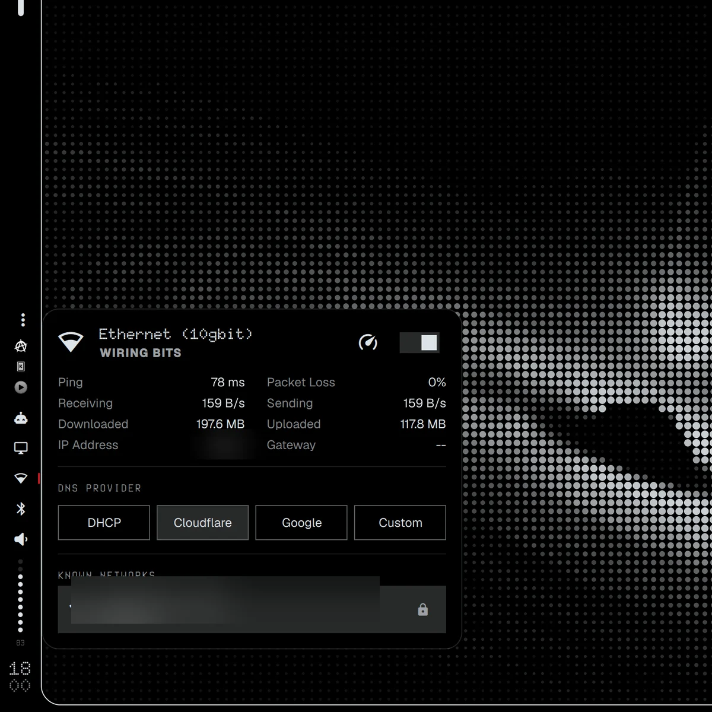

# Omarchy DOT-MATRIX Wi-Fi

[🇬🇧 English](README.md)

Панель сети и Wi-Fi: сети, сигнал, сведения о подключении — стоковый виджет бара [Omarchy](https://omarchy.org) (`omarchy.network`), перерисованный в стиле **DOT-MATRIX**:
точечные шрифты в духе Nothing OS, плоские карточки с тонкой рамкой, палитра по текущей теме Omarchy (или
исходная чёрно-бело-красная).

Из семейства DOT-MATRIX-плагинов: [скины бара](https://github.com/KamradSmeshnyavy/omarchy-bar-skins), [Customizer](https://github.com/KamradSmeshnyavy/omarchy-customizer) и
[другие DOT-MATRIX-панели](https://github.com/KamradSmeshnyavy?tab=repositories&q=omarchy-dotmatrix).



<!-- Demo video: repo-videos/omarchy-dotmatrix-network.mp4 — drag it here when editing this file on GitHub -->

## Установка

```sh
omarchy plugin add https://github.com/KamradSmeshnyavy/omarchy-dotmatrix-network --enable
omarchy restart shell
```

`--enable` спросит, в какую секцию бара поставить виджет. Стоковый `omarchy.network` уберите из бара, если не нужны оба.

## Требования

Omarchy 4 (Quattro) с его оболочкой. Проверено на Omarchy 4.0.6 и Quickshell 0.3.2.

- Ничего, кроме Omarchy — панель использует те же сервисы, что и стоковая.
- Шрифты: точечные шрифты DOT-MATRIX (Doto, Space Grotesk, Space Mono) идут с [Customizer](https://github.com/KamradSmeshnyavy/omarchy-customizer); без них —
  шрифт Omarchy.

## Удаление

```sh
omarchy plugin remove kamradsmeshnyavy.network
omarchy restart shell
```

Стоковый виджет `omarchy.network` верните в бар в настройках бара, если убирали.

## Корпоративные сети (802.1X)

Для новой сети WPA-Enterprise панель просит логин, **домен сервера** (например, `radius.example.org`, его
знает ваш IT-отдел) и пароль. Профиль создаётся как PEAP/MSCHAPv2 и доверяет только серверу, чей сертификат
подписан системным CA и совпадает с этим доменом: поддельная точка доступа с тем же именем не получит ваши данные
входа. Пароль уходит в NetworkManager через stdin, а не через командную строку. Сети со своим CA-сертификатом
настраиваются один раз в `nm-connection-editor`, дальше панель подключается к ним как к известным.

## Настройки

Палитра общая для всех DOT-MATRIX-плагинов: `~/.config/omarchy/dotmatrix.json`
(`{"palette": "theme"}` — цвета текущей темы, по умолчанию; `{"palette": "mono"}` — исходный вид Nothing). Любую
роль можно переопределить там же или в [Customizer](https://github.com/KamradSmeshnyavy/omarchy-customizer) → Виджеты → Палитра DOT-MATRIX.

## Лицензия

MIT — см. [LICENSE](LICENSE) и [NOTICE](NOTICE). Основа — стоковый плагин Omarchy `omarchy.network` (MIT).

Часть [моих dotfiles](https://github.com/KamradSmeshnyavy/dotfiles).
